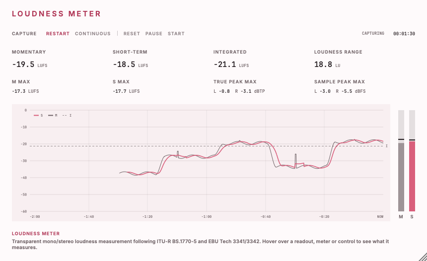

# Loudness Meter

A transparent mono/stereo loudness meter: Momentary, Short-term, Integrated, loudness range, sample peak and true peak.<br>
Part of the codycodie plug-in collection.

Loudness Meter measures what passes through it and changes nothing: audio leaves sample for sample
as it came in, with zero added latency. It follows ITU-R BS.1770-5 and EBU Tech 3341/3342, but it
is engineering validation only; the plug-in is not certified by EBU or ITU.



**Editor.** A fixed-aspect, white and soft-rose panel that scales from 0.75x to 2x (the scale is
saved in the plug-in state). The four primary readouts are Momentary, Short-term, Integrated and
LRA, with the maxima and the per-channel sample and true peaks beneath them (L and R when
stereo). A status lane shows the capture duration and state, and faults are set in a separate
colour. The history graph plots the last 10 minutes of Momentary and Short-term readings on the
same 0 to -60 LUFS scale as the level bars beside it; a dark mark on each bar shows its maximum
and a dashed line shows the current Integrated value. Hover help covers every control, readout,
bar and the graph. Fonts: Inter SemiBold and JetBrains Mono Medium, bundled.

Loudness Meter is an independent product identity: product `Loudness Meter`, company `codycodie`,
bundle identifier `com.c0dypeng.loudnessmeter`, manufacturer code `Cdpg` and plug-in code `Ldmt`.
It builds as AU and VST3, mono-to-mono and stereo-to-stereo. This repository is licensed under
GPL-3.0 (see [LICENSE](LICENSE)).

## Downloads

Get the latest packages from the [Loudness Meter releases page](https://github.com/chijenpeng/loudness-meter/releases/latest).
The macOS release contains Universal AU and VST3 bundles for Apple Silicon and Intel; the bundles
are ad-hoc signed and not notarized. The Windows release contains a native x64 VST3, unsigned. Each
ZIP includes `INSTALL.txt`, `THIRD_PARTY_NOTICES.md`, `LICENSE`, the dependency licences and build
provenance, with a `.sha256` companion file.

## Controls

| Control | Type | What it does |
|---|---|---|
| Capture | Restart / Continuous | The only automated parameter (`captureMode`, shown to the host as "Capture Mode"). Restart holds readings and history while the host is stopped, then clears the whole capture before the first sample of the next play. Continuous ignores host play/stop and position jumps. Changing the mode starts a new capture. |
| Reset | Command | Clears the readings, maxima, peaks, duration and history at the next audio block and keeps capturing. A paused meter stays paused. |
| Pause | Command | Finishes the bounded true-peak tail, then stops measuring and holds every reading and the history. Audio still passes unchanged. Only Start resumes. |
| Start | Command | Clears everything, leaves Pause and begins a new capture at the next eligible sample. In Restart mode it waits empty while the host is stopped. |

Reset, Pause and Start are runtime commands, not automation parameters. There is no target,
threshold or warning setting.

What it measures:

- **Momentary:** ungated 400 ms K-weighted loudness, updated every 100 ms.
- **Short-term:** ungated 3 s loudness, updated every 100 ms.
- **Integrated:** two-stage gated loudness of every eligible complete 400 ms block in the capture.
- **LRA:** the range of the gated Short-term windows, the 95th minus the 10th percentile. It is
  marked UNSTABLE until the capture reaches 60 seconds.
- **Maxima:** the highest valid Momentary and Short-term readings in the capture.
- **Sample peak and true peak:** per channel, in dBFS and dBTP, held for the capture. True peak is
  an oversampled reconstruction estimate; values above 0 dBFS are kept.
- **Duration:** captured audio time, silence included.
- **History:** the last 10 minutes of Momentary and Short-term readings.

A dash means a reading is not yet available; minus infinity means digital silence. Measurements
are scheduled on the audio sample count, so the same signal gives the same readings whatever the
host block size. A seek or loop during play marks a discontinuity and keeps the completed
statistics. A bypassed plug-in stops measuring and starts a fresh capture when bypass ends.
Closing or reopening the editor never changes the capture. The saved state holds only Capture and
the editor scale; measurements are not restored, so a restored session starts empty and unpaused.

## Limits

- Not certified. It follows ITU-R BS.1770-5 and EBU Tech 3341/3342 but has not been tested or
  approved by EBU, ITU or any other body, and it is not claimed to match any other meter.
- Mono or stereo only. There is no multichannel mode, gain processing, limiter, normalization,
  file import or Standalone application.
- Supported sample rates are exactly 32, 44.1, 48, 88.2, 96, 176.4, 192, 352.8 and 384 kHz. Other
  rates, including 22.05 kHz and fractional rates, leave audio untouched and the meter shows an UNSUPPORTED RATE
  fault; they are never rounded to a supported rate.
- True peak uses a fixed windowed-sinc interpolator whose oversampling follows the rate (8x at 32
  to 48 kHz, 4x at 88.2 and 96 kHz, 2x at 176.4 and 192 kHz, 1x at 352.8 and 384 kHz). The tested
  band runs from DC to the lower of 20 kHz and 0.45 times the sample rate; that is not a proof for
  every waveform.
- A host that gives no stop, release or end callback leaves the final true-peak tail unmeasured.
- Capture stops at exactly 24 hours and holds, flagged CAPTURE LIMIT, until Reset or the next play
  edge.
- macOS runtime has been checked on Apple Silicon only; the Intel slice has been built but not
  run. No DAW session has been run.
- Windows is an unsigned native x64 VST3 only (no AU, as for the other codycodie releases) and may
  need the Microsoft Visual C++ x64 Redistributable.

## Build

CMake 3.22 or later and a C++17 compiler. For AU and VST3 builds use macOS 11 or later; the Windows
VST3 release uses native x64 MSVC from Visual Studio 2022. Python 3 is needed for the reference
tests. JUCE 8.0.9: a checkout or symlink at `third_party/JUCE` is used when present, otherwise
CMake fetches the tagged release.

```sh
cmake -S . -B build -G Ninja -DCMAKE_BUILD_TYPE=Release
cmake --build build -j4
ctest --test-dir build --output-on-failure
```

For a universal macOS build add `-DCMAKE_OSX_ARCHITECTURES="arm64;x86_64"`. Plug-in copying is
disabled by default (`-DCOPY_PLUGIN_AFTER_BUILD=ON` copies the AU and VST3 bundles into the user's
Audio Plug-Ins folders). Build products are under `build/LoudnessMeter_artefacts/Release`.
Both bundles carry readable notices under `Contents/Resources/Notices/`; see
[THIRD_PARTY_NOTICES.md](THIRD_PARTY_NOTICES.md).

## Validation and snapshots

CTest runs six tests, all of which pass: independent reference calculations in C++ and in Python
(the Python one is stdlib only) and a cross-check between them; the production loudness and
true-peak cores; and the real JUCE processor, which checks exact audio passthrough, the host
lifecycle, bypass, the stated limits and the saved state. The tests use generated signals only; no
recordings are needed. They check against the standards' rules, not against another meter.

`loudness_snapshot` renders the real processor and editor without a host or screen, at 1x, 0.75x
and 2x, and writes the output file with `-min` and `-max` siblings. `docs/editor.png` is its
default output, driven by a deterministic 90 second synthetic programme.

```sh
cmake --build build --target loudness_snapshot
./build/loudness_snapshot_artefacts/Release/loudness_snapshot docs/editor.png \
  [input.wav] [--mono] [--state empty|silence|invalid|paused|unsupported|long] [--help-for "TITLE"]
```

A WAV input must be 16, 24 or 32-bit PCM, or 32-bit float, and mono or stereo. `--state` renders
an edge case and `--help-for` renders the hover help for the given title; the run exits with code 7
if any help text overflows its three-line body. The Windows package is built and tested natively
by the manual `windows-release.yml` workflow.
